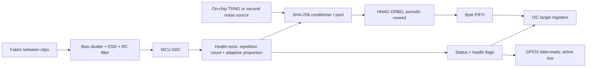

# SAO random number generator (fabric entropy)

Status: prepped 2026-11-09, nothing built. Research pass: three-part parts review (links inline). Items tagged *(unverified)* were not confirmed against a primary source; *(recommendation)* is our proposal.

## Goal

An SAO that harvests entropy from a piece of fabric clamped between two binder clips (or similar), turns it into health-tested random bytes, and serves them over I2C to the other boards on the badge. GPIO2 can signal "data ready".

**Assumption to confirm:** "fabric between two binder clips" means the clips are the two electrodes and the fabric is a conductive or piezoresistive element (Velostat-style, carbon or silver fabric). If you meant something else (a triboelectric rub, a capacitive plate), the analog front end changes, the rest of this brief does not.

## The honest physics

- The fabric is a **contact-resistance sensor**. Its resistance moves with pressure, flex, humidity and temperature. That signal is mostly deterministic and environmental, and an attacker next to the badge can influence it. Piezoresistive sheets also drift and show hysteresis ([example test, about 21 % at 1 kg](https://sciforum.net/paper/download/16586/manuscript)).
- **Johnson noise** of the element is far below an ADC step: at 300 K and 100 kOhm it is about 41 nV/rtHz, so about 4 uV in 10 kHz. One LSB of a 12-bit ADC at 3.3 V is about 806 uV. Without gain you are mostly measuring ADC, reference, supply and mains-pickup noise, not the fabric's thermal noise. *(our calculation, sqrt(4kTRB))*
- Plan for a **low or even near-zero assessed min-entropy per sample** from the fabric alone, and measure it. A realistic guess is 0.1 to 0.5 bit/sample at 1 to 10 kS/s, so roughly 100 to 5,000 bits/s before conditioning *(our estimate, needs a bench measurement)*.
- The clips are therefore best treated as a **supplementary entropy source that is mixed in**, plus a fun physical interface. They are the headline feature, not the sole security basis.

## Recommended architecture *(recommendation)*

Pipeline (the minimal credible one from the research): raw samples, continuous health tests (SP 800-90B repetition count and adaptive proportion), offline min-entropy estimate with NIST's `ea_non_iid` on at least 1 M raw samples, SHA-256 conditioning with at least 2x input entropy, HMAC-DRBG expansion with periodic reseed.

### MCU choice (decision needed, see [open questions](#open-questions))

| Option | For | Against |
|---|---|---|
| **RP2350** *(recommended)* | Built-in TRNG with health checks, 12-bit ADC, I2C target, USB bootloader for easy reflash. About $0.80 on reel, $1.10 single. | Larger BOM (flash, crystal, regulator); datasheet itself says its drivers reduce but do not eliminate NIST test failures. [datasheet](https://pip-assets.raspberrypi.com/categories/1214-rp2350/documents/RP-008373-DS-3-rp2350-datasheet.pdf) |
| CH32V003 | About $0.14, tiny, matches the 2024 Supercon add-on precedent, CH32fun tooling | **No TRNG** (verified: no RNG in [reference manual v1.5](https://components101.com/sites/default/files/component_datasheet/CH32V003RM.PDF)); the fabric/ADC would be the only source, which is the weakest case above. Needs an external noise source. |
| nRF52840 / ESP32-C3 | Thermal-noise RNG, about 33 kB/s raw (nRF) | Radio parts are overkill and costlier; ESP32-C3 is only truly random with the radio or SAR source enabled |
| ATECC608B | I2C RNG "designed to meet" SP 800-90A/B/C | Microchip lists it NRND and the full datasheet is under NDA |

Second independent source if not on RP2350: reverse-biased zener avalanche (Betrusted uses a 15 V zener from a boost converter at about 0.53 mA, [writeup](https://betrusted.io/avalanche-noise)). Costs area and a boost converter; not for revision A.

## Analog front end sketch

- Divider from 3.3 V through a fixed resistor near the fabric's nominal resistance into the ADC pin; 10 to 100 kOhm series resistor; about 100 nF anti-alias.
- **ESD:** users will touch the clips. Series resistor, TVS (for example ESD5Z3.3) and Schottky clamps to the rails.
- 50/60 Hz will dominate. Shield or guard the lead, AC-couple or high-pass; if you want to see actual thermal noise you need an op-amp with gain of about 100 to 1000.
- Leave a footprint for a second element (reference fabric, or fixed resistor) to compare against.
- Clip leads: 2-pin 2.54 mm header or screw terminal so any clip/lead works. Make this a **separate, clearly labeled connector**, not SAO pins.

## I2C interface (draft, ours)

Fits the intelligent-SAO draft in [electrical-and-interop.md](../../research/specs/electrical-and-interop.md#draft-elements-of-a-reusable-intelligent-sao-protocol). Address: pick in the [system address map](../system-overview.md#i2c-address-plan).

| Reg | Name | Purpose |
|---|---|---|
| 0x00 | ID / version | read-only; device class + protocol version |
| 0x01 | STATUS | bit0 DATA_RDY, bit1 HEALTH_FAIL, bit2 STARTUP_DONE, bit3 OVERRUN |
| 0x02 | CTRL | enable, raw-debug mode, flush |
| 0x03 | FIFO_LEVEL | bytes available |
| 0x04 | READ | pops conditioned bytes |
| 0x05 | RESEED_CNT | reseed counter |
| 0x06 | ENTROPY_EST | assessed bits/sample, 1/256 fixed point |

Rules:
- **Consume-on-read:** bytes are never served twice, so two host boards sharing the bus cannot get the same output. A read of n bytes is atomic and n must not exceed FIFO_LEVEL; when empty return an error flag, never zeros presented as data.
- **Health failure** flushes the FIFO, stops output and sets HEALTH_FAIL.
- **Raw debug mode** disables conditioned output so raw samples never mix with it.
- Throughput ceiling is about 11 kB/s at 100 kHz and about 44 kB/s at 400 kHz *(our arithmetic)*; the real limit is the entropy seed rate, not the bus.
- Reset defaults, byte order and repeated-START behaviour must be written down (see the decisions list in the shared doc).

## Claims policy

May say: "raw noise health-tested, SHA-256 conditioned, HMAC-DRBG expanded; measured min-entropy X bits/sample with NIST `ea_non_iid` on N samples."
May not say: "NIST-compliant", "FIPS", "cryptographic grade", "validated", without a certificate. Do not tell badge authors to seed keys from it without mixing in the OS source.

## Verification plan

1. Bench: sample the fabric into a file on a dev board (RP2350 Pico 2 or similar) for 1 M+ samples under several conditions (still, tapped, humid, mains nearby).
2. Run `ea_non_iid` ([NIST tool](https://github.com/usnistgov/SP800-90B_EntropyAssessment)) and take the lowest estimate; also `ent` and dieharder on conditioned output (they cannot prove quality, only catch gross faults).
3. Native unit tests for health tests, conditioner, DRBG and the register state machine (desktop build first, per [dev-environment](../../research/dev-environment.md)).
4. Fault injection: clip shorted, clip open, stuck ADC, mains injection; health tests must trip.
5. Fixture: multiple hosts reading concurrently, bytes never duplicate.

## First-prototype plan

1. Pico 2 + fabric on a breadboard: collect raw data, decide the real entropy rate. **Go/no-go gate for the whole project.**
2. Firmware core (health tests, conditioner, DRBG, register map) with desktop tests.
3. KiCad schematic: SAO header, RP2350, flash, crystal, AFE, clip connector, test pads (GND, 3V3, SDA, SCL, ADC).
4. First board: two-layer, conservative, DNP pull-ups.

## Open questions

- Which MCU: RP2350 (recommended) or CH32V003 plus an external noise source?
- Is the fabric conductive/piezoresistive (assumed), or something else?
- Do you want the fabric to be the only source, or is mixing with an on-chip TRNG acceptable? (Recommended: mix.)
- Which fabric: need to buy and measure Velostat, silver and steel fabric. EeonTex and conductive thread were not researched *(unverified)*.
- Do we want an unvalidated "random numbers for fun" device, or a stated target (BSI AIS 31 / SP 800-90B assessment) for the writeup?

## Sources

[Betrusted avalanche noise](https://betrusted.io/avalanche-noise) · [NIST SP 800-90B](https://doi.org/10.6028/NIST.SP.800-90B) · [SP 800-90A r1](https://csrc.nist.gov/pubs/sp/800/90/a/r1/final) · [BSI AIS 31](https://www.bsi.bund.de/SharedDocs/Downloads/EN/BSI/Certification/Interpretations/AIS_31_Functionality_classes_for_random_number_generators_e.pdf) · [Infinite Noise TRNG](https://github.com/waywardgeek/infnoise) · [Linux hw_random](https://docs.kernel.org/admin-guide/hw_random.html) · [nRF52840 RNG](http://docs.nordicsemi.com/r/bundle/ps_nrf52840/page/rng.html) · [ESP32-C3 random](https://docs.espressif.com/projects/esp-idf/en/latest/esp32c3/api-reference/system/random.html) · [ATECC608B](https://cdn.sparkfun.com/assets/a/3/7/1/9/ATECC608B_datasheet.pdf)

Could not open: Microchip product page (403), 3M Velostat datasheet, CH32V003 datasheet (only the reference manual).
