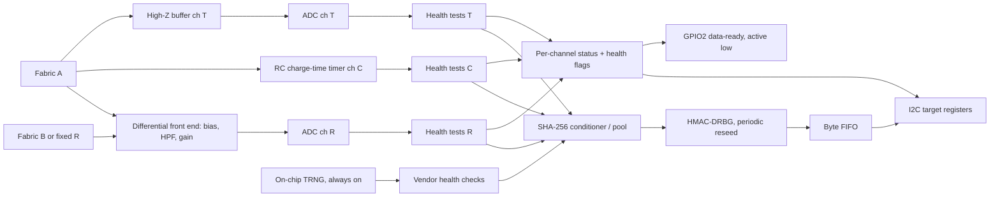

# SAO random number generator (fabric entropy)

Status: prepped 2026-11-09, nothing built. Research pass: three-part parts review (links inline). Items tagged *(unverified)* were not confirmed against a primary source; *(recommendation)* is our proposal.

## Goal

An SAO that harvests entropy from a piece of fabric clamped between two binder clips (or similar), turns it into health-tested random bytes, and serves them over I2C to the other boards on the badge. GPIO2 can signal "data ready".

**Assumption to confirm:** "fabric between two binder clips" means the clips are the two electrodes and the fabric is a conductive or piezoresistive element (Velostat-style, carbon or silver fabric). If you meant something else (a triboelectric rub, a capacitive plate), the analog front end changes, the rest of this brief does not.

## The honest physics

- The fabric is a **contact-resistance sensor**. Its resistance moves with pressure, flex, humidity and temperature. That signal is mostly deterministic and environmental, and an attacker next to the badge can influence it. Piezoresistive sheets also drift and show hysteresis ([example test, about 21 % at 1 kg](https://sciforum.net/paper/download/16586/manuscript)).
- **Johnson noise** of the element is far below an ADC step: at 300 K and 100 kOhm it is about 41 nV/rtHz, so about 4 uV in 10 kHz. One LSB of a 12-bit ADC at 3.3 V is about 806 uV. Without gain you are mostly measuring ADC, reference, supply and mains-pickup noise, not the fabric's thermal noise. *(our calculation, sqrt(4kTRB))*
- Plan for a **low or even near-zero assessed min-entropy per sample** from the fabric alone, and measure it. A realistic guess is 0.1 to 0.5 bit/sample at 1 to 10 kS/s, so roughly 100 to 5,000 bits/s before conditioning *(our estimate, needs a bench measurement)*.
- The clips are therefore best treated as a **supplementary entropy source that is mixed in**, plus a fun physical interface. They are the headline feature, not the sole security basis.

### What to measure (decision of 2026-11-09)

Entropy lives in the **fluctuation** of the signal, not its level. The DC resistance of the fabric is slow, predictable and attacker-influenceable; the part worth harvesting is the contact noise on top of it. Three design rules follow, all drawn up as the front end below:

1. **Measure fluctuations, not level:** AC-couple the divider and put a gain stage ahead of the ADC, so the ADC sees the noise and not the drift. Without gain the MCU ADC mostly digitises its own noise (a 12-bit LSB is about 806 uV; 100 kOhm Johnson noise is about 4 uV in 10 kHz).
2. **Measure differentially:** two fabric pieces (or one plus a fixed resistor) as a pair, so temperature, mains pickup and supply ripple cancel and what remains is closer to the independent part of the signal.
3. **Run several channels and mix them:** resistance noise, capacitance and tribo voltage fail in different ways. Each channel has its **own** health tests; a failed channel is dropped and the pool carries on.

Candidate channels:

| Ch | Property | Read by | Fails when |
|---|---|---|---|
| R | resistance fluctuation (contact noise), differential, AC-coupled + gain | ADC | clips shorted/open, mains pickup, saturation |
| C | capacitance between the clips (fabric as electrode/dielectric) | RC charge time on a GPIO, timed (PIO on RP2350) | humidity step, hand proximity, too-slow timer resolution |
| T | triboelectric voltage while the fabric is rubbed or flexed | high-impedance buffer into ADC | fabric not moving (then the signal is nothing), ESD |
| J | thermal (Johnson) noise floor | same amp as R, high gain, differential | amplifier noise dominates; probably unreachable on a SAO, include only as a bench measurement |

*Excess (contact) noise in resistive carbon composites generally grows with bias current, so more bias gives the amplifier more signal. **Unverified for these fabrics**: it is general physics, not tested, and the bias is capped by the power budget and by heating of the fabric. The bench test below measures it (bias sweep).*

Caveat that does not change: every channel is partly environmental and can be influenced by someone handling the clips. The fabric is still a supplementary source mixed with the MCU's TRNG; the credited entropy comes from measurement.

## Recommended architecture *(recommendation)*

Pipeline (the minimal credible one from the research): raw samples per channel, continuous per-channel health tests (SP 800-90B repetition count and adaptive proportion), offline min-entropy estimate per channel with NIST's `ea_non_iid` on at least 1 M raw samples, SHA-256 conditioning with at least 2x input entropy, HMAC-DRBG expansion with periodic reseed.

Mixing rules:
- **Each channel has its own health tests and its own entropy credit.** A channel that fails is dropped from the pool and flagged; the others and the on-chip TRNG continue. If every fabric channel fails the device still runs on the TRNG and says so in STATUS.
- **Credit conservatively:** use the lowest assessed min-entropy per channel, and do not count channels twice if they are correlated. Cross-correlate the channels offline during the bench test, and only credit the sum for channels that test independent.
- Raw samples stay in separate buffers per channel; only the conditioner sees the pool.

### MCU choice (decision needed, see [open questions](#open-questions))

| Option | For | Against |
|---|---|---|
| **RP2350** *(recommended)* | Built-in TRNG with health checks, 12-bit ADC, I2C target, USB bootloader for easy reflash. About $0.80 on reel, $1.10 single. | Larger BOM (flash, crystal, regulator); datasheet itself says its drivers reduce but do not eliminate NIST test failures. [datasheet](https://pip-assets.raspberrypi.com/categories/1214-rp2350/documents/RP-008373-DS-3-rp2350-datasheet.pdf) |
| CH32V003 | About $0.14, tiny, matches the 2024 Supercon add-on precedent, CH32fun tooling | **No TRNG** (verified: no RNG in [reference manual v1.5](https://components101.com/sites/default/files/component_datasheet/CH32V003RM.PDF)); the fabric/ADC would be the only source, which is the weakest case above. Needs an external noise source. |
| nRF52840 / ESP32-C3 | Thermal-noise RNG, about 33 kB/s raw (nRF) | Radio parts are overkill and costlier; ESP32-C3 is only truly random with the radio or SAR source enabled |
| ATECC608B | I2C RNG "designed to meet" SP 800-90A/B/C | Microchip lists it NRND and the full datasheet is under NDA |

Second independent source if not on RP2350: reverse-biased zener avalanche (Betrusted uses a 15 V zener from a boost converter at about 0.53 mA, [writeup](https://betrusted.io/avalanche-noise)). Costs area and a boost converter; not for revision A.

## Analog front end *(recommendation, sketch)*

### Channel R: differential resistance noise

- **Bias:** fabric A and fabric B (or A and a fixed resistor of similar value) each in a divider from a low-noise bias node; the differential pair goes to the amplifier. Bias current is **selectable** (jumper or DNP resistor set, later a DAC/PWM) so the bench test can sweep it. Start near 10 to 50 uA *(our guess)*.
- **AC coupling:** a high-pass of about 1 to 10 Hz to remove drift, then gain. Re-bias the signal to mid-rail (VCC/2, buffered) because the board is single-supply 3.3 V.
- **Gain:** about 100 to 1000, adjustable by DNP resistors. Target: noise of several LSB peak-to-peak at the ADC without clipping. Worked check: 100 kOhm Johnson is about 4 uV over 10 kHz, so Johnson alone needs gain near 200 just to reach one LSB; contact noise should be larger, which is what the bench test decides.
- **Op-amp selection criteria (part not picked):** rail-to-rail in/out, 3.3 V, low input bias current, low voltage-noise density, low supply current, available at JLCPCB. Pick from the bench results.
- **Anti-alias:** low-pass at about 1/2 the sample rate before the ADC; sample at 1 to 10 kS/s.
- **Mains:** the differential pair rejects common-mode 50/60 Hz; also add a notch or higher HPF corner if the bench shows residual hum.

### Channel C: capacitance

Fabric A against the clip lead as a plate pair; charge through a known resistor from a GPIO and time to a threshold, or run a small RC oscillator and count. Timer resolution (PIO on RP2350) sets the noise floor. Slow and low-rate; the point is an independent failure mode, not bandwidth.

### Channel T: triboelectric

High-impedance unity-gain buffer from a clip into an ADC pin, with a bleed resistor to bias. Only produces signal while the fabric moves. ESD is the hazard here: users will touch the clips.

### Common to all channels

- **ESD:** series resistor, TVS (for example ESD5Z3.3) and Schottky clamps to the rails on every clip lead.
- **Guard / shield:** shielded or twisted lead; guard ring around the high-impedance nodes.
- **Layout:** analog section away from the MCU's switching; supply ripple matters because differential rejects common-mode ripple only up to the matching of the two arms.
- **Connector:** a separate, clearly labeled 2 to 4 pin connector (clip A, clip B/reference, shield, optional), not SAO pins.
- **Pin budget:** RP2350A has few ADC inputs; this needs R, T and temperature/reference monitoring. Count against the exact package before choosing RP2350A vs B *(ADC input counts unverified in our research pass, check the datasheet)*.
- **Realistic rate:** at 1 to 10 kS/s and 0.1 to 0.5 assessed bits/sample, expect roughly 100 to 5,000 bits/s of raw min-entropy per channel before conditioning *(our estimate; the bench test replaces it)*.

## I2C interface (draft, ours)

Fits the intelligent-SAO draft in [electrical-and-interop.md](../../research/specs/electrical-and-interop.md#draft-elements-of-a-reusable-intelligent-sao-protocol). Address: pick in the [system address map](../system-overview.md#i2c-address-plan).

| Reg | Name | Purpose |
|---|---|---|
| 0x00 | ID / version | read-only; device class + protocol version |
| 0x01 | STATUS | bit0 DATA_RDY, bit1 HEALTH_FAIL, bit2 STARTUP_DONE, bit3 OVERRUN |
| 0x02 | CTRL | enable, raw-debug mode, flush |
| 0x03 | FIFO_LEVEL | bytes available |
| 0x04 | READ | pops conditioned bytes |
| 0x05 | RESEED_CNT | reseed counter |
| 0x06 | ENTROPY_EST | assessed bits/sample of the pool credit, 1/256 fixed point |
| 0x07 | CH_ENABLE | bit0 R, bit1 C, bit2 T, bit3 on-chip TRNG; sources included in the pool |
| 0x08 | CH_HEALTH | per-channel health: bit set = that channel failed its health tests and is excluded |
| 0x09 | CH_EST[0..3] | per-channel assessed bits/sample, 1/256 fixed point (R, C, T, TRNG) |

Rules:
- **Consume-on-read:** bytes are never served twice, so two host boards sharing the bus cannot get the same output. A read of n bytes is atomic and n must not exceed FIFO_LEVEL; when empty return an error flag, never zeros presented as data.
- **Channel health failure** drops only that channel from the pool and sets its CH_HEALTH bit; output continues from the remaining sources. **HEALTH_FAIL** (flush FIFO, stop output) is raised only when no source is left healthy, or the on-chip TRNG itself fails.
- **Raw debug mode** disables conditioned output so raw samples never mix with it.
- Throughput ceiling is about 11 kB/s at 100 kHz and about 44 kB/s at 400 kHz *(our arithmetic)*; the real limit is the entropy seed rate, not the bus.
- Reset defaults, byte order and repeated-START behaviour must be written down (see the decisions list in the shared doc).

## Claims policy

May say: "raw noise health-tested, SHA-256 conditioned, HMAC-DRBG expanded; measured min-entropy X bits/sample with NIST `ea_non_iid` on N samples."
May not say: "NIST-compliant", "FIPS", "cryptographic grade", "validated", without a certificate. Do not tell badge authors to seed keys from it without mixing in the OS source.

## Verification plan

1. **Channel bench test (go/no-go and design input).** On a dev board with an adjustable analog front end, for **each** channel (R, C, T, J) and for each fabric type, capture 1 M+ raw samples under: still, tapped, flexed, humid, mains cable nearby, clip shorted, clip open. For channel R also **sweep bias current** and **gain**, with the differential pair and with a single-ended baseline, to see what each rule buys.
2. Run `ea_non_iid` ([NIST tool](https://github.com/usnistgov/SP800-90B_EntropyAssessment)) per channel and take the lowest estimate. Compare against the ADC's own noise floor measured with the input shorted, and drop any channel that does not beat it.
3. **Cross-channel independence:** cross-correlation and a combined-stream `ea_non_iid` run; credit the sum only for channels that test independent.
4. `ent` and dieharder on the conditioned output (they cannot prove quality, only catch gross faults).
5. Native unit tests (desktop build first, per [dev-environment](../../research/dev-environment.md)) for per-channel health tests, the mixing/credit logic, conditioner, DRBG and the register state machine, including channel drop and recovery.
6. **Fault injection per channel:** clip shorted, clip open, stuck ADC, mains injection, one channel disabled mid-stream; the failing channel must trip its own health bit and the others must keep the pool running.
7. Fixture: multiple hosts reading concurrently, bytes never duplicate.

## First-prototype plan

1. **Front-end bench rig:** Pico 2 (or similar) plus a breadboard analog front end: bias/HPF/gain stage with swappable resistors, differential input for two fabric pieces, a capacitance timing pin, a high-Z tribo input. Capture raw data per channel and fabric to a file. **Go/no-go gate for the whole project**, and the source of the front-end component values.
2. Firmware core (per-channel health tests, mixing, conditioner, DRBG, register map) with desktop tests.
3. KiCad schematic from the bench-chosen values: SAO header, RP2350, flash, crystal, differential front end with DNP gain/bias options, C and T channels as populated or DNP, clip connector, test pads (GND, 3V3, SDA, SCL, ADC taps, amp output).
4. First board: two-layer, conservative, DNP pull-ups; analog section placed away from the MCU.

## Open questions

- Which MCU: RP2350 (recommended) or CH32V003 plus an external noise source?
- Is the fabric conductive/piezoresistive (assumed), or something else?
- Do you want the fabric to be the only source, or is mixing with an on-chip TRNG acceptable? (Recommended: mix.)
- Which fabric: need to buy and measure Velostat, silver and steel fabric. EeonTex and conductive thread were not researched *(unverified)*.
- Two fabric pieces: should the second clip pair be a second fabric piece (more to clamp) or a fixed reference resistor on the board (simpler)? The bench test compares both.
- How many channels go on the first board: R only, or R + C + T populated? (Recommended: footprints for all, populate per bench results.)
- RP2350A or RP2350B for ADC pin count *(unverified)*.
- Do we want an unvalidated "random numbers for fun" device, or a stated target (BSI AIS 31 / SP 800-90B assessment) for the writeup?

## Sources

[Betrusted avalanche noise](https://betrusted.io/avalanche-noise) · [NIST SP 800-90B](https://doi.org/10.6028/NIST.SP.800-90B) · [SP 800-90A r1](https://csrc.nist.gov/pubs/sp/800/90/a/r1/final) · [BSI AIS 31](https://www.bsi.bund.de/SharedDocs/Downloads/EN/BSI/Certification/Interpretations/AIS_31_Functionality_classes_for_random_number_generators_e.pdf) · [Infinite Noise TRNG](https://github.com/waywardgeek/infnoise) · [Linux hw_random](https://docs.kernel.org/admin-guide/hw_random.html) · [nRF52840 RNG](http://docs.nordicsemi.com/r/bundle/ps_nrf52840/page/rng.html) · [ESP32-C3 random](https://docs.espressif.com/projects/esp-idf/en/latest/esp32c3/api-reference/system/random.html) · [ATECC608B](https://cdn.sparkfun.com/assets/a/3/7/1/9/ATECC608B_datasheet.pdf)

Could not open: Microchip product page (403), 3M Velostat datasheet, CH32V003 datasheet (only the reference manual).
