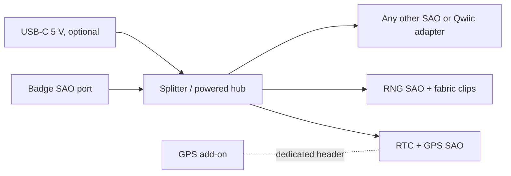

# How the three SAOs fit together

Covers [RTC + GPS](rtc-gps/README.md), [RNG](rng/README.md) and [splitter](splitter/README.md). Everything here is a **proposal**; the numbers come from the three briefs and are not measured.

## Shared rules

- 3.3 V only, signals at most 3.6 V, 330 ohm series on SAO-driven GPIO, no backfeed into the badge, DNP pull-ups (see [electrical-and-interop](../research/specs/electrical-and-interop.md)).
- Both intelligent SAOs expose **register 0x00 = device class + protocol version** so a host can tell them apart before using them. The class values are to be assigned in a decision record.
- Both follow the draft intelligent-SAO conventions (status byte, explicit commands, reset defaults).
- The splitter stays passive on I2C in rev 1, so these two boards must not clash on the bus by design.

## I2C address plan

Provisional. **Nothing here has been checked against a real badge.** Scan the target badge and the Billboard badge's onboard devices (the Billboard shares SDA GPIO17 / SCL GPIO18 across three ports, see [badge note](../research/badges/2026-supercon-billboard.md)) before fixing any address.

| Device | Address | Note |
|---|---|---|
| Badge.team ID EEPROM | 0x50 | optional per SAO; two on one bus collide, a passive splitter cannot fix that |
| RV-3028 | 0x52 | only in "plain" RTC mode; hidden behind the MCU in "smart" mode |
| u-blox M10 I2C (DDC) | 0x42 | not used when the GPS runs on UART behind the MCU |
| I2C muxes (PCA9546A/TCA9548A) | 0x70 to 0x77 | avoid; reserved for the future smart hub |
| Common RTCs / OLED | 0x68, 0x3C/0x3D | avoid |
| **RTC + GPS MCU** | proposed 0x2C, strap to 0x2D | provisional |
| **RNG MCU** | proposed 0x2E, strap to 0x2F | provisional |

Every intelligent SAO should have an address strap pad so two of the same board, or a clash with a host device, is fixable without reflashing.

## Power budget

Per-port ceiling is about 250 mA at 3.3 V by the v1.69bis "1.1 millihorsepower" figure, a ceiling and not a guarantee ([source](https://hackaday.com/2019/03/20/introducing-the-shitty-add-on-v1-69bis-standard)). Many badges supply much less.

| Load | Figure | Source |
|---|---|---|
| RV-3028 timekeeping | 45 nA | datasheet |
| u-blox M10 GPS | 8 to 13 mA acquisition, 7.5 to 10 mA tracking | datasheet |
| Quectel L76K GPS | 26 mA, 100 mA supply recommended | datasheet |
| RNG SAO (MCU + analog) | **not measured** | measure on prototype |
| Splitter overhead (LEDs, LDO quiescent) | **not measured** | measure on prototype |

All three together fit under 250 mA on paper, but a weak badge port is the realistic failure. That is what the splitter's USB path is for.

## Decisions to record

Put each in `decisions/` as a short record: target spec version (v1.69bis or Simple Add-On pin-1 convention), device class numbers, byte order and register conventions, address plan, MCU family policy, repo layout for firmware (`core/protocol/platform`).

## Build order *(recommendation)*

1. **RNG** front-end bench test first (differential, AC-coupled, multi-channel capture and per-channel entropy assessment). It is the go/no-go for the project (the fabric may give near-zero entropy).
2. **RTC + GPS** dev-board proof (PPS capture, discipline loop).
3. **Splitter** A+B board, because it is needed to power and chain the other two on a real badge.
4. Integrate on a real badge and check the address plan.
