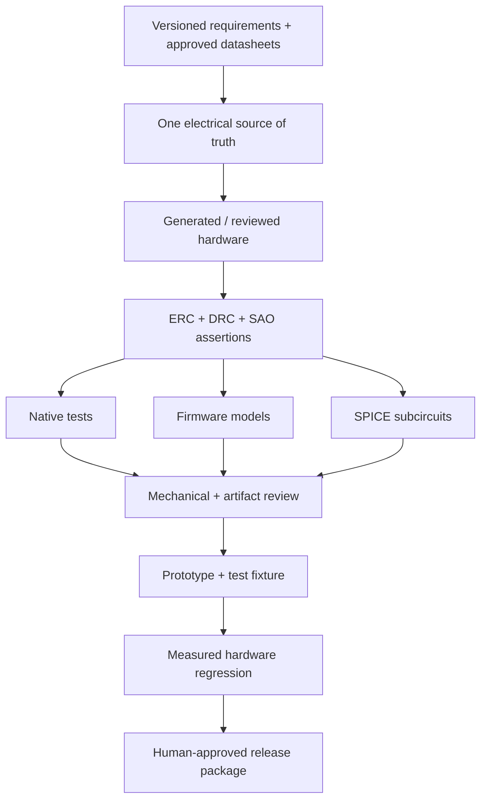

# Development environment and verification workflow

Research pass of 2026-11-09 (pasted into the session; links are the sources it cited). Tool capability claims are **vendor documentation, not tested by us**. Items marked *(my recommendation)* are proposals from the research pass, not facts.

Core idea: no single "SAO emulator" exists. Connector, PCB, firmware, power integrity and host compatibility are separate verification problems, so use a **layered** setup and wire it together deliberately.

## Verification layers

| Layer | Tool | Establishes | Does not establish |
|---|---|---|---|
| Electrical rules | KiCad ERC, SKiDL checks | Connectivity/type mistakes the rule model can see | Right component, correct operation |
| PCB rules | KiCad DRC | Configured clearance/geometry/routing | Functional correctness |
| Analog | KiCad + ngspice | Voltages, currents, transients of the modelled circuit | Firmware, unmodelled parasitics |
| Firmware execution | Wokwi | Firmware vs supported/modelled peripherals | PCB correctness |
| System emulation | Renode | Firmware/system on supported modelled hardware | Universal MCU/peripheral coverage |
| Mechanical | KiCad 3D/STEP + CAD | Geometry, interference | Connector tolerance/strength |
| Physical | Custom fixture | Real assembled behaviour | Every environment/lifetime case |

A Wokwi breadboard is not a PCB simulation. A 3D render is not an electrical test. A clean DRC means the *configured* rules pass, not that the rules capture every requirement.

## PCB and circuit tools

| Tool | Does | Assessment |
|---|---|---|
| [KiCad](https://www.kicad.org/) | Schematic, layout, DRC, manufacturing/3D export | Canonical final design |
| [KiCad CLI](https://docs.kicad.org/10.0/en/cli/cli.html) | Headless ERC/DRC, exports, jobsets | Foundation for CI and agent checks |
| [KiCad IPC API](https://dev-docs.kicad.org/en/apis-and-binding/ipc-api/) | Structured remote control of running KiCad | Better than mouse automation; not headless |
| [SKiDL](https://devbisme.github.io/skidl/) | Python-defined connectivity, ERC, netlists | Good if Python is the source; layout still needs review |
| [tscircuit](https://github.com/tscircuit/tscircuit) | TypeScript/React circuits, routing, KiCad + SPICE export ([docs](https://docs.tscircuit.com/command-line/tsci-export)) | Good for code generation; validate exports independently |
| [atopile](https://atopile.io/) | Hardware-as-code, modules, agentic layout/routing | Worth evaluating, fast-moving; v0.16.15 blog (Oct 2026) says agent can place+route but impedance, SI and thermal validators are still missing ([post](https://atopile.io/blog/atopile-0-16-15)) |
| [Quilter](https://www.quilter.ai/) | Automated placement/routing from an existing design | Layout service only |

| Goal | Proposed stack |
|---|---|
| Fastest dependable first SAO | KiCad + CLI checks + Wokwi + native firmware tests |
| Python-driven reusable hardware | SKiDL + KiCad + custom constraint scripts |
| TypeScript-first AI generation | tscircuit + independent KiCad validation |
| Agentic exploration | atopile with exported artifacts and independent checks |
| Outsource layout | Quilter after freezing intent, connector, critical constraints |

**Rule: pick one electrical source of truth.** Do not mix SKiDL, tscircuit and atopile in the first project.

## Firmware emulation

- **Wokwi** (first choice for fast prototyping): [docs](https://docs.wokwi.com/), [custom chips](https://docs.wokwi.com/chips-api/getting-started) (C to WASM, Chips API still beta), [I2C API](https://docs.wokwi.com/chips-api/i2c) (connect/read/write/disconnect callbacks). Model the SAO as a custom I2C peripheral to test the **host protocol**. That does *not* run the real SAO MCU firmware; that needs the MCU supported in the emulator. CI uses [YAML automation scenarios](https://docs.wokwi.com/wokwi-ci/automation-scenarios). Free CI allowance listed as 50 min per rolling 30 days; paid tiers listed 200/500/2000 min; dollar prices not verified.
- **Renode** ([testing](https://renode.readthedocs.io/en/latest/introduction/testing.html), [supported boards](https://renode.readthedocs.io/en/latest/introduction/supported-boards.html)): Robot Framework, unattended CI, reproducible multi-device models. Before choosing an MCU check its interrupt controller, timers, I2C, DMA are modelled, not just the CPU core.
- **Native tests: always.** Layering: application logic, device/protocol interface, hardware abstraction, MCU drivers. Build the first two for desktop too. Fastest edit-run-diagnose loop, especially for AI-driven work.

## SPICE ([KiCad ngspice](https://www.kicad.org/discover/spice/))

Simulate small critical subcircuits with explicit limits, not an impressive whole-board model with poor models.

| Subcircuit | Question |
|---|---|
| Power input | Source/cable/header resistance, sudden load |
| Decoupling | Droop for a representative current pulse |
| LEDs and drivers | Current, dissipation, headroom |
| Multiplexed display | Peak currents, switching transients |
| Input filters | Debounce without sluggishness |
| Level translation | Levels and edges valid |
| Battery isolation | Can either source drive the other |
| I2C pull-ups | Resistance/capacitance corners |

A schematic symbol is not automatically a usable SPICE model.

## CI checks (KiCad CLI, flags to confirm against installed version)

```sh
export PATH="/Applications/KiCad/KiCad.app/Contents/MacOS:$PATH"   # macOS bundle location
kicad-cli version
mkdir -p build && kicad-cli sch erc --exit-code-violations --format json --output build/erc.json hardware/sao.kicad_sch
kicad-cli pcb drc --schematic-parity --refill-zones --exit-code-violations --format json --output build/drc.json hardware/sao.kicad_pcb
# only after the checks pass:
kicad-cli pcb export gerbers --output build/fab/ hardware/sao.kicad_pcb && kicad-cli pcb export drill --output build/fab/ hardware/sao.kicad_pcb
```

A custom output dir does not replace choosing and reviewing the fabrication layers.

### SAO-specific assertions to script (standard ERC/DRC cannot express these)

Connector pads match approved net map; GPIO output paths include the required series R; every supply-connected part supports the rail; no host backfeed path; address inventory has no unintended collision; pull-up inventory with expected equivalent R; test/programming pads exist; part pinout and footprint pad map approved; connector/outline unchanged without review; BOM has manufacturer, exact part, footprint and DNP state; firmware protocol version matches host driver. A generic netlist parser cannot infer every electrical hazard.

## AI automation

Not "ask AI to draw a board", but constrained editing tools + machine-readable requirements + independent validators.

| Route | Available | Caution |
|---|---|---|
| KiCad CLI | Stable checks and exports | Not a general editing engine |
| KiCad IPC API | Control running KiCad | Version-dependent; GUI session assumptions |
| atopile agents | Placement/routing with validator feedback | Missing advanced validators |
| tscircuit / SKiDL | Text source, agent-friendly diffs | Outputs still need independent validation |
| [Ki-Stack](https://github.com/Milind220/Ki-Stack) | Community skills around CLI/IPC/verification | Claims only |
| [kicad-cli-extended](https://github.com/Hybirdss/kicad-cli-extended) | Community wrapper: editing, routing, JSON contracts | Recent; test on disposable fixtures |

Guardrails *(my recommendation)*: agent cannot silently waive ERC/DRC; connector, outline and keepouts locked; exact part numbers required; every assertion has provenance; test expectations written independently of the implementation; deterministic exports (reviewed board = fabricated board); no automatic purchasing or release; bounded retries.

## Regression test matrix (proposed)

| Area | Cases | Layer |
|---|---|---|
| Discovery | present, absent, unsupported version | native + modelled host |
| I2C transactions | partial read/write, repeated START, invalid register | model + real bus |
| Robustness | NACK, timeout, reset mid-access | sim + fixture |
| Inputs | bounce, rapid rotation, simultaneous buttons | native + fixture |
| Queues | full, empty, overflow, stalled consumer | native |
| Display | max brightness, update bursts, corrupt command | native + sim + current measurement |
| Clock | rollover, invalid time, missing RTC | native + device model |
| Power | startup, peak, brownout, repeated cycles | SPICE + physical |
| Unpowered | bus behaviour, leakage/backfeed | physical |
| Compatibility | several hosts and add-ons, varied pull-ups | physical |
| Long run | memory, queue, watchdog, event loss | sim + soak |
| Mechanical | fit, operating force, retention | physical |

## Test fixture (proposed, not a standard)

Known SAO socket and pinout; current-limited 3.3 V; switchable power; switchable pull-ups; configurable I2C host; GPIO stimulus/readback; measurement points; programming interface; host script API; result logging (firmware rev, board serial, current, failures). Precedent: [2024 Supercon 8 Add-On Badge](https://github.com/Hack-a-Day/2024-Supercon-8-Add-On-Badge). Background: [atopile on hardware testing](https://atopile.io/blog/how-to-win-at-hardware-testing).

Use the homelab as CI/control plane but isolate the rig from untrusted PR execution: a job that toggles real supplies or flashes a board needs tighter access than a compiler job. (Our CI-host conventions are in the user's global instructions.)

## Reference designs

| Resource | Take |
|---|---|
| [Simple Add-On project](https://hackaday.io/project/175182-simple-add-ons-sao) | Connector footprints, symbols, backside labelling |
| [2024 Supercon official repo](https://github.com/Hack-a-Day/2024-Supercon-8-Add-On-Badge) | Host/add-on integration, CH32V003 |
| [2026 Billboard repo](https://github.com/Hack-a-Day/2026-Billboard_Badge) | Host hardware, GPIO map, app structure ([our note](badges/2026-supercon-billboard.md)) |
| [Supercon-SAO (disquisitioner)](https://github.com/disquisitioner/Supercon-SAO) | Community examples, non-normative |
| [KiCad forum: Supercon redraw](https://forum.kicad.info/t/hackaday-supercon-badge-redrawing-effort-2024/55771) | Importing a board is not a coherent schematic-to-PCB project |

Official and maintainer docs carry requirements; forums and community repos are supplemental.

## Cost (planning, not quotes)

KiCad $0; SKiDL open source; Wokwi $0 browser personal use, free CI allowance, paid prices unverified; Quilter free tier for eligible personal/academic use, check terms ([source](https://www.quilter.ai/free-ai-pcb-design)); atopile pricing not verified. Custom fixture roughly $20-80 excluding instruments; small SAO prototype batch roughly $30-150. Assembly, displays, batteries, odd outlines and shipping can dominate.

## Proposed workflow and repo shape



The research pass suggested `requirements/` (interface.yaml, power-budget.csv, address-map.yaml, verification-plan.md), `hardware/`, `firmware/{core,protocol,platform}`, `host/billboard/`, `models/wokwi/`, `tests/{native,protocol,simulation,hardware}`, `tools/`, `docs/`, `.github/workflows/`. Our repo already splits into `research/`, `planning-design/`, `workbench/`; mapping is a decision for `planning-design/decisions/`, not made yet.

**First milestone** *(proposed)*: a virtual SAO that identifies itself, accepts a command, exposes a counter/event queue and recovers from reset. Implement the same interface on a real MCU, validate with the fixture, and only then add the display, RTC, radio or artistic PCB.
