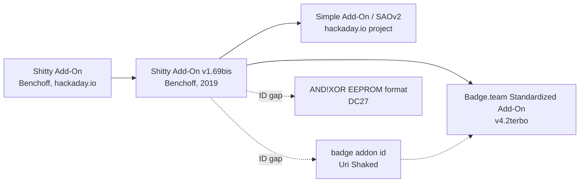

# SAO specs

| File | Content |
|---|---|
| [`badge-team-sao.md`](badge-team-sao.md) | Badge.team "Standardized Add-On v4.2terbo": pinout, `0x50` EEPROM identification, header identifiers |
| [`v1.69bis.md`](v1.69bis.md) | Shitty Add-On v1.69bis (Hackaday, 2019): limits, LED/UART conventions |
| [`simple-add-on-v2.md`](simple-add-on-v2.md) | Simple Add-On v2: identical electrically, rebrand + footprint |
| [`badge-team-binary-descriptor.md`](badge-team-binary-descriptor.md) | `LIFE` binary EEPROM descriptor byte layout |
| [`badge-addon-id.md`](badge-addon-id.md) | Uri Shaked's original `LIFE` / `JSON` descriptors |
| [`andnxor-eeprom.md`](andnxor-eeprom.md) | AND!XOR DC27 year/maker/type EEPROM format |
| [`electrical-and-interop.md`](electrical-and-interop.md) | Electrical limits, I2C traps, compatibility claims, architectures, physical constraints |

## Lineage

| Version | Defines | Identification |
|---|---|---|
| [Shitty Add-On v1.69bis](v1.69bis.md) | 6-pin connector, 3.6 V max, 330 ohm GPIO resistor, 1.1 mhp, GPIO/LED/UART conventions | None. "No way to tell" |
| [AND!XOR EEPROM (DC27)](andnxor-eeprom.md) | `[year][maker][type][data]` at `0x50` | Ad hoc, no magic |
| [badge-addon-id](badge-addon-id.md) | `LIFE` binary or `JSON` descriptor at `0x50` | Magic-checked |
| [Simple Add-On v2](simple-add-on-v2.md) | Identical to v1.69bis; new name and footprint; data pins optional | None |
| [Badge.team v4.2terbo](badge-team-sao.md) | Pinout, no-backfeed; [`LIFE`](badge-team-binary-descriptor.md) adds extra-driver count and first-byte repair | `0x50` EEPROM, safe probe order |

**Simple Add-On v2 vs v1.69bis:** no electrical or pin differences, per the SAOv2 author. Differences are naming, KiCad footprints, and an explicit statement that only VCC and GND are guaranteed.
