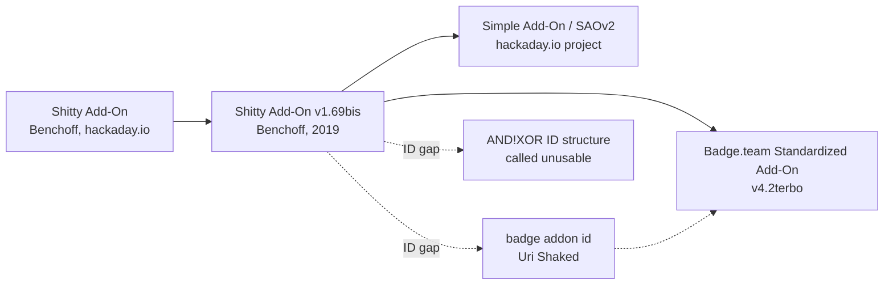

# SAO specs

| File | Content |
|---|---|
| [`badge-team-sao.md`](badge-team-sao.md) | Badge.team "Standardized Add-On v4.2terbo": pinout, `0x50` EEPROM identification, header identifiers |
| [`electrical-and-interop.md`](electrical-and-interop.md) | Electrical limits, I2C traps, compatibility claims, architectures, physical constraints |

## Lineage

| Version | Defines | Identification |
|---|---|---|
| Shitty Add-On v1.69bis | 6-pin connector, electrical limits, GPIO/LED/UART conventions | AND!XOR structure (per Badge.team: unusable) |
| Simple Add-On (SAOv2) | Same connector, KiCad symbols/footprints, data pins optional | not covered in our sources |
| Badge.team v4.2terbo | Pinout and no-backfeed rule | `0x50` EEPROM, `LIFE` / `JSON` / `TEAM` headers |

The version-difference row for Simple Add-On is thin. Filling it in is an open task in [`../research-log.md`](../research-log.md).
