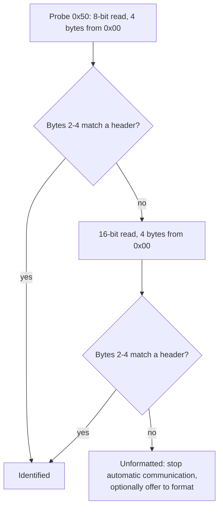

# Badge.team: SAO: Standardized Add-On (v4.2terbo)

- **Source:** <https://badge.team/docs/standards/sao/>
- **Captured:** 2026-11-09 (page last modified 2026-11-06, upstream commit `27ad94c`)
- **Status of this file:** faithful restatement of the page, with our notes marked **Note**. Not a verbatim copy.
- **Child page:** "Binary SAO descriptor" (header `LIFE`) is captured in [badge-team-binary-descriptor.md](badge-team-binary-descriptor.md).

## Summary

Badge.team's standard defines the connector, the pinout, and an optional I2C EEPROM for identifying the add-on. It builds on two earlier community efforts (see [lineage](README.md#lineage)). It is the only one of the sources we have that specifies identification.

**Note:** this page expands SAO as "Standardized Add-On". The 2019 Hackaday material says "Shitty Add-On" and the later Hackaday.io project says "Simple Add-On". Same connector, different names. Use "SAO" in our own docs.

## History (as the page tells it)

1. The standard began as a joke: the *Shitty Add-On* standard, published as a hackaday.io project by Brian Benchoff, then revised as **Shitty Add-On v1.69bis** (also Benchoff).
2. v1.69bis defines the **electrical characteristics** but gives **no usable way to identify** which add-on is connected.
3. The fix referenced is the *badge addon id* standard by Uri Shaked. The identification method v1.69bis points to is described by AND!XOR, and the page calls that data structure unusable.
4. Badge.team's response is the **Standardized Add-On v4.2terbo** standard, described as guaranteed to improve compatibility and "might also somehow be faster". The tone is a joke; the pin and EEPROM content is real.

## Connector

- Add-on connects to the badge by a **2x3 (two rows, three columns), 2.54 mm pitch female socket** on the badge side, mating with a standard 2x3 male header on the add-on.
- Use a **keyed connector** on the badge if possible. With a shrouded header on the add-on it prevents wrong orientation or position.

| Pin | Function | Notes |
|-----|----------|-------|
| 1 | 3.3 V power | Powers the add-on. **Do not feed power back into a connected badge.** |
| 2 | GND | Reference |
| 3 | SDA | I2C data |
| 4 | SCL | I2C clock |
| 5 | GPIO1 | General purpose in/out 1. Also data pin for WS2812 (NeoPixel) and APA102 (DotStar) addressable LEDs |
| 6 | GPIO2 | General purpose in/out 2. Also clock pin for APA102 (DotStar) LEDs, and interrupt input |

## Identification

An add-on may provide an **EEPROM at I2C address `0x50`**.

- Both small EEPROMs (**8-bit** memory address) and bigger ones can be used. The page literally says "bigger (**32-bit** address length)" (re-read 2026-11-09). That is almost certainly an error for 16-bit, since the same page's safe procedure and hazard both talk about 16-bit addresses and real I2C EEPROMs use 1- or 2-byte addresses.
- **Hazard:** small EEPROMs interpret a read using a 16-bit address as a **write** command, per the page. People can accidentally overwrite data in small EEPROMs this way. **Enabling write-protect on small identification EEPROMs is strongly recommended.**

### Safe identification procedure

1. **8-bit read** of 4 bytes starting at memory address `0x00` of the EEPROM at `0x50`.
2. **Ignore byte 1.** Compare bytes 2, 3 and 4 against the header table below.
3. If no match, do a **16-bit read** of 4 bytes from address `0x00`. Again ignore byte 1 and compare bytes 2 to 4.
4. If still no match, the SAO is **unformatted**. Avoid any further automatic communication. Optionally prompt the user to format the add-on.

Why byte 1 is ignored: an accidental 16-bit read to an 8-bit-address EEPROM can corrupt the first byte. Ignoring it still lets a damaged add-on be recognised.

### Header identifiers

Bytes 1 to 4 as ASCII. Byte 1 is ignored on read, so the match is on the last three characters of the 4-byte header.

| 1 | 2 | 3 | 4 | Description | Documentation |
|---|---|---|---|-------------|---------------|
| `L` | `I` | `F` | `E` | Binary descriptor | [badge-team-binary-descriptor.md](badge-team-binary-descriptor.md) (upstream `/docs/standards/sao/binary_descriptor/`) |
| `J` | `S` | `O` | `N` | JSON text descriptor | none upstream; defined in [badge-addon-id.md](badge-addon-id.md) |
| `T` | `E` | `A` | `M` | Reserved for Badge.team use | none |

**Note:** since byte 1 is ignored, the matched part is `IFE`, `SON`, `EAM`.

## Notes and gaps

- The page has no electrical limits (no current budget, no signal-voltage ceiling, no GPIO series-resistor rule). Those come from the v1.69bis text, see [v1.69bis.md](v1.69bis.md) and [electrical constraints](electrical-and-interop.md).
- Identification is optional. Many hosts will not probe `0x50`, so an EEPROM is useful but is not universal auto-detection. See [electrical-and-interop.md](electrical-and-interop.md#identification-support-is-not-universal).
- Stray typos on the page: trailing `\` after "format the addon", "accidently", "determined unformatted".
